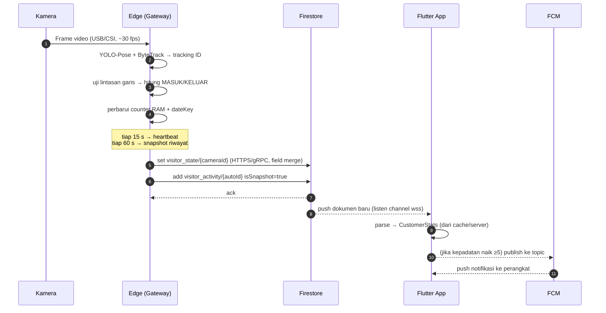
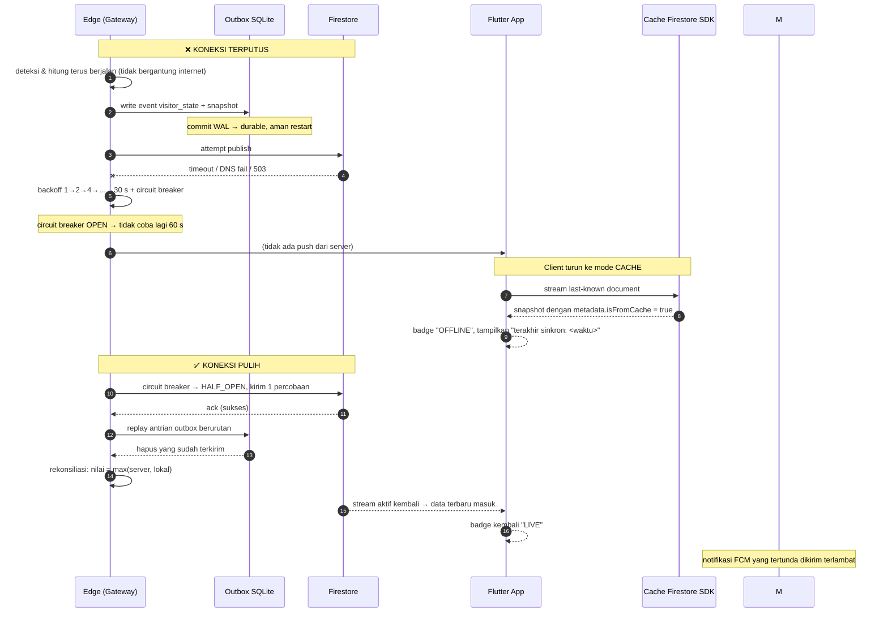
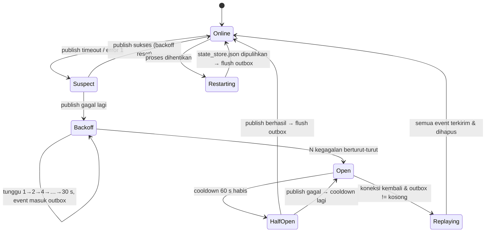
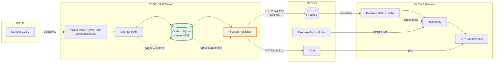

# Analisa Arsitektur Smart Customer — Jawaban Soal UTS

Dokumen ini menjawab langsung soal analisa:

> **Soal:** Gambarkan diagram alur arsitektur, kemudian jelaskan:
> **a.** Komponen dan protokol komunikasi pada setiap koneksi
> **b.** Data yang diproses atau disimpan secara lokal oleh gateway
> **c.** Apa yang terjadi ketika koneksi internet terputus lalu tersambung kembali
> **d.** Kelebihan dan kekurangan arsitektur dari sisi latensi, keandalan, dan ketergantungan terhadap internet

> **Acuan:** dokumen rancangan lengkap ada di [`ARSITEKTUR_UTS.md`](./ARSITEKTUR_UTS.md). Dokumen ini merangkum dan menganalisisnya.

---

## 0. Gambaran Besar Sistem (1 paragraf)

Smart Customer adalah sistem pemantauan kepadatan pengunjung minimarket berbasis IoT. Satu kamera CCTV menangkap video, sebuah edge computer (Raspberry Pi / PC) menjalankan model YOLO Pose + ByteTrack untuk menghitung orang yang melintasi garis, lalu mengirim angka agregat (jumlah orang di dalam, total masuk, total keluar) ke Google Firestore. Aplikasi Flutter membaca angka itu secara *realtime* lewat Firebase Cloud Firestore SDK dan menampilkan dashboard occupancy, grafik, riwayat, serta notifikasi FCM ketika kepadatan melewati ambang batas.

Seluruh sistem bersifat **cloud-centric**: komputasi AI berada di sisi edge, tetapi **state (keadaan) disimpan di server**. Konsekuensi paling penting dari fakta ini adalah: ketika internet mati, edge tetap bisa menghitung, tetapi tidak bisa mengirim — dan aplikasi sisi klien langsung kehilangan satu-satunya sumber data. Rancangan offline beserta analisisnya diuraikan pada §2–§5 dokumen ini.

> **Catatan terminologi.** Dalam dokumen ini:
> - **Gateway** = edge device yang menjalankan `computer_vision/count_customers.py` (istilah "gateway" pada soal crypto diartikan sebagai perangkat tepi yang menjembatani dunia fisik ke cloud).
> - **Server** = Google Cloud Platform (Firestore, FCM, Firebase Auth).
> - **Client** = aplikasi Flutter (Android / Web).

---

## 1. Diagram Alur Arsitektur

### 1.1 Diagram Arsitektur Keseluruhan (Online + Offline dalam satu gambar)

```mermaid
graph TB
    subgraph FIELD["Lapis 1 — Field / Fisik"]
        CAM["Kamera CCTV<br/>(USB / CSI)"]
        ORANG["Pengunjung minimarket"]
    end

    subgraph EDGE["Lapis 2 — Edge / Gateway (Raspberry Pi / PC)"]
        CAP["OpenCV VideoCapture<br/>baca frame 640x480"]
        YOLO["Ultralytics YOLO-Pose<br/>deteksi + keypoint"]
        BT["ByteTrack<br/>ID unik per orang"]
        LOGIC["Logika Garis Batas<br/>line-ratio 0.55<br/>atas→bawah = MASUK<br/>bawah→atas = KELUAR"]
        COUNTER["Counter RAM<br/>entries / exits / inside<br/>dateKey = hari ini"]
        PUB["FirestorePublisher<br/>(Admin SDK, service account)"]
        OUTBOX["OUTBOX SQLite (WAL)<br/>antrian publish + backoff"]
        STATE["STATE FILE JSON<br/>snapshot lokal atomik"]
        ALERT["send_crowd_alert()<br/>FCM topic"]
    end

    subgraph CLOUD["Lapis 3 — Cloud (Google Cloud)"]
        FS[("Firestore<br/>visitor_state /<br/>visitor_activity")]
        FA["Firebase Auth<br/>+ users/{uid}.role"]
        FCM["Firebase Cloud Messaging<br/>topic: smart_customer_alerts"]
        RULES["Firestore Rules<br/>(server-side authority)"]
    end

    subgraph CLIENT["Lapis 4 — Client (Flutter)"]
        AUTH["Firebase Auth SDK<br/>(session + cache)"]
        SDK["Cloud Firestore SDK<br/>listen channel + cache lokal"]
        REPO["Repository<br/>(sumber kebenaran tunggal)"]
        MIRROR["Local Mirror<br/>(SharedPreferences / IndexedDB)"]
        UI["Dashboard, Grafik,<br/>Riwayat, Analitik"]
        NOTIF["FCM Client<br/>+ flutter_local_notifications"]
    end

    ORANG --> CAM
    CAM -- "USB 2.0 / CSI (UVC)"| USB |" --> CAP
    CAP --> YOLO --> BT --> LOGIC --> COUNTER
    COUNTER --> PUB
    PUB -- "① tulis dulu ke outbox"| FS |" --> OUTBOX
    OUTBOX -- "② kirim when online"| FS |" --> PUB
    PUB -- "HTTPS 443 + gRPC<br/>Service Account JWT"| FS |" --> FS
    STATE <--> PUB
    PUB -- "kepadatan ≥ 5 (naik)"| FCM |" --> ALERT
    ALERT -- "HTTPS 443 HTTP v1 API"| FCM |" --> FCM

    FS --> RULES
    FS -- "wss:// long-lived listen"| SDK |" --> SDK
    SDK --> REPO --> UI
    MIRROR <--> REPO
    SDK <--> MIRROR
    FA -- "REST HTTPS 443"| AUTH |" --> AUTH
    AUTH --> REPO
    RULES -- "validasi role"| AUTH |" --> AUTH
    FCM -- "push channel"| FCM |" --> NOTIF
    NOTIF --> UI

    style OUTBOX fill:#e8f5e9,stroke:#2e7d32,stroke-width:2px
    style STATE fill:#e8f5e9,stroke:#2e7d32,stroke-width:2px
    style MIRROR fill:#e8f5e9,stroke:#2e7d32,stroke-width:2px
    style PUB fill:#fff3e0,stroke:#ef6c00,stroke-width:2px
```

### 1.2 Diagram Alur Data Normal (Online)



### 1.3 Diagram Alur Saat Internet Terputus



---

## (a) Komponen dan Protokol Komunikasi pada Setiap Koneksi

### a.1 Tabel Komponen per Lapisan

| # | Komponen | Lokasi | Tugas Utama | Teknologi |
|---|----------|--------|-------------|----------|
| 1 | Kamera CCTV | Field | Menghasilkan frame video 640×480 @ ±30 fps | Sensor UVC, USB 2.0 / CSI ribbon |
| 2 | OpenCV `VideoCapture` | Edge | Membaca frame dari `/dev/video0` | Driver UVC Linux + V4L2 |
| 3 | YOLO-Pose (Ultralytics) | Edge | Deteksi orang + 17 keypoint, ~20–40 ms/frame | PyTorch, CPU/GPU, ONNX ops |
| 4 | ByteTrack | Edge | ID unik per orang, menghindari hitung ganda | Implementasi internal Ultralytics |
| 5 | Logika garis batas | Edge | Menentukan event MASUK / KELUAR | `line-ratio` 0.55, arah gerak keypoint |
| 6 | Counter RAM | Edge | Akumulator `entries`, `exits`, `inside`, `dateKey` | Variabel Python di memori |
| 7 | **Outbox SQLite** *(target)* | Edge | Antrean publish yang tahan mati-listrik | SQLite mode WAL, `synchronous=FULL` |
| 8 | **State File JSON** *(target)* | Edge | Snapshot counter terakhir, tulis atomik | `Path.replace()` (atomic rename) |
| 9 | `FirestorePublisher` | Edge | Menulis ke Firestore via Admin SDK | google-cloud-firestore (Python) |
| 10 | `send_crowd_alert()` | Edge | Memicu notifikasi ambang batas | google-cloud-messaging (Python) |
| 11 | Cloud Firestore | Cloud | Penyimpanan dokumen status & riwayat | Firestore v1 API |
| 12 | Firebase Auth | Cloud | Identitas pengguna + role | Identity Platform REST |
| 13 | Firestore Security Rules | Cloud | Otorisasi baca/tulis di sisi server | Rules engine |
| 14 | FCM | Cloud | Push notification ke perangkat | FCM HTTP v1 API |
| 15 | Firebase Auth SDK | Client | Menyimpan sesi login | REST HTTPS |
| 16 | Cloud Firestore SDK | Client | Listen realtime + cache dokumen | Listen channel (WebSocket/gRPC) |
| 17 | Repository | Client | Sumber kebenaran tunggal (server ⇄ lokal) | Abstraksi Dart |
| 18 | Local Mirror | Client | Cermin data untuk mode offline | SharedPreferences / IndexedDB |
| 19 | Halaman UI | Client | Dashboard, grafik, riwayat, analitik | Flutter + Riverpod |
| 20 | Notification Service | Client | Menampilkan notifikasi lokal | flutter_local_notifications |

### a.2 Protokol pada Setiap Hop (Koneksi)

| # | Dari → Ke | Data yang Dikirim | Protokol / Mekanisme | Port / Endpoint | Keterangan |
|---|-----------|-------------------|----------------------|-----------------|------------|
| 1 | Kamera → Edge | Frame video mentah | **USB 2.0 / CSI**, UVC class video (V4L2) | `/dev/video0` (bukan network) | Lossless, tanpa latensi jaringan; gagal hanya karena driver/USB |
| 2 | Edge (OpenCV) → Edge (YOLO) | Image numpy BGR | **In-process**, shared memory / numpy array | — | ~2–5 ms |
| 3 | Edge → Firestore | Dokumen status `visitor_state/{cameraId}` | **HTTPS 443 + gRPC** (Firestore v1), autentikasi **OAuth2 / JWT service account** | `firestore.googleapis.com` | Field-level `merge` → idempotent |
| 4 | Edge → Firestore | Dokumen riwayat `visitor_activity/{autoId}` | **HTTPS 443 + gRPC**, sama seperti di atas | `firestore.googleapis.com` | `add()` dengan `isSnapshot=true`, *append-only* |
| 5 | Edge → FCM | Pesan notifikasi ke topic `smart_customer_alerts` | **HTTPS 443**, FCM HTTP v1 API, **OAuth2 service account** | `fcm.googleapis.com` | Dijalankan bila kepadatan naik dari <5 ke ≥5 |
| 6 | Firestore → Client | Dokumen `visitor_state` / `visitor_activity` | **Long-lived listen channel**: WebSocket `wss://` (Web SDK) / gRPC (mobile SDK), fallback polling REST | `firestore.googleapis.com` | Snapshot awal dari cache, lalu update *push* |
| 7 | Client → Firebase Auth | Login/registrasi | **HTTPS 443**, Identity Platform REST | `identitytoolkit.googleapis.com` | Token ID JWT disimpan di penyimpanan aman |
| 8 | Client → Firestore Rules | Permintaan baca | **HTTPS 443**, diteraikan di sisi server | — | Client **read-only**; tulis hanya lewat Admin SDK (melewati rules) |
| 9 | FCM → Perangkat | Notifikasi push | **Push channel** (XMPP/HTTPS delivery) | `fcm.googleapis.com` | Foreground → `flutter_local_notifications`; background → system tray |
| 10 | Edge (lokal) | Antrean outbox & counter | **SQLite WAL** (sistem file lokal) | `edge_outbox.db` | Tidak butuh jaringan; tahan restart |

### a.3 Ringkasan Protokol yang Digunakan

| Kategori | Protokol | Di Mana |
|----------|----------|---------|
| Sensor ↔ Edge | USB 2.0 / CSI (UVC) | Kamera → Raspberry Pi |
| Edge → Cloud | HTTPS/443 + gRPC (Firestore v1), HTTPS/443 (FCM v1) | Publish data & alert |
| Edge (lokal) | SQLite WAL, atomic file rename | Outbox & state persistence |
| Cloud → Client | WebSocket `wss://` / gRPC listen channel | Realtime push |
| Client → Cloud | HTTPS/443 REST | Auth, login, fallback polling |
| Cloud → Client | FCM push channel | Notifikasi |

> **Tidak ada protokol proprietary.** Semua yang dipakai adalah HTTP/2 (gRPC di atasnya), TLS, WebSocket, dan SQLite — berarti mudah di-debug lewat DevTools Network, dan tidak terikat vendor selain Firebase.

### a.4 Kontrak Akses Data (siapa boleh apa)

| Resource | Edge (Admin SDK) | Admin | Operator | Viewer | Client biasa |
|----------|-------------------|-------|----------|--------|--------------|
| `visitor_state/{cameraId}` | **write** (bypass rules) | read | read | read | read |
| `visitor_activity/{id}` | **write** | read | read | read | read |
| `users/{uid}` | read | read | read | read | read (dokumen sendiri) |
| `users/{uid}.role` | read | read | read | read | read (dokumen sendiri) |
| **tulis dari client** | — | ❌ | ❌ | ❌ | ❌ (ditolak rules) |

Konsekuensi penting: **seluruh jalur tulis melewati perangkat klien** — tidak ada risiko tabel/route diubah langsung dari HP, dan tidak ada kebutuhan sinkronisasi tulis dua arah.

---

## (b) Data yang Diproses atau Disimpan Secara Lokal oleh Gateway

### b.1 Data yang Diproses (di memori, tidak disimpan)

| Data | Struktur | Dihasilkan oleh | Dipakai untuk |
|------|----------|-----------------|---------------|
| `entries` | `int` | Event lintasan atas→bawah | Menghitung `totalMasuk` |
| `exits` | `int` | Event lintasan bawah→atas | Menghitung `totalKeluar` |
| `current_inside` | `int` | `entries - exits` | Angka occupancy yang ditampilkan |
| `dateKey` | `str` (`YYYY-MM-DD`) | Jam sistem lokal | Mengganti hitungan harian saat lewat tengah malam |
| Track buffer ByteTrack | `{id, bbox, keypoints}` | YOLO-Pose | Menentukan arah & kontinuitas lintasan |
| `count_changed` | `bool` | Logika event | Penanda "perlu publish" |
| `last_snapshot_at` | `float` (epoch) | Timer | Interval snapshot 60 s |

### b.2 Data yang Diberikan oleh Gateway (payload ke server)

Semua dokumen memakai skema field yang sama:

| Field | Tipe | Arti | Sumber |
|-------|------|------|--------|
| `cameraId` | string | ID kamera (`minimarket-main`) | argumen `--camera-id` |
| `dateKey` | string | Tanggal operasional (`YYYY-MM-DD`) | jam lokal edge |
| `jumlahDiDalam` | int | Occupancy saat ini | RAM |
| `totalMasuk` | int | Akumulasi masuk hari ini | RAM |
| `totalKeluar` | int | Akumulasi keluar hari ini | RAM |
| `maxCapacity` | int | Kapasitas toko (default 40) | argumen `--max-capacity` |
| `sensorOnline` | bool | Kamera & proses hidup? | health check |
| `updatedBy` | string | `edge-publisher` | konstanta |
| `schemaVersion` | int | Versi skema data | konstanta |
| `timestamp` | `ServerTimestamp` | Waktu otoritatif server | SERVER_TIMESTAMP |
| `isSnapshot` | bool | `true` jika dokumen riwayat | penanda snapshot |

Dokumen ditulis ke dua koleksi:
- `visitor_state/{cameraId}` — **status terkini**, ditulis dengan `set` + merge (field-level).
- `visitor_activity/{autoId}` — **riwayat**, ditulis dengan `add`, `isSnapshot=true`, append-only.

### b.3 Data yang Disimpan Lokal — kondisi saat ini vs target

| Aspek | Implementasi **sekarang** | Rancangan **target offline** |
|-------|---------------------------|------------------------------|
| Counter (masuk/keluar/di dalam) | ⚠️ **Hanya di RAM** — hilang saat restart | ✅ State file JSON atomik, ditulis tiap perubahan/interval |
| Antrean publish | ❌ Tidak ada — gagal publish **dibuang** | ✅ SQLite `outbox` (WAL), tulis-dulu-kirim-kemudian |
| Retry | ⚠️ Coba ulang **setiap frame** (~30×/detik) saat gagal | ✅ Backoff eksponensial 1→2→4→…→30 s + circuit breaker 60 s |
| State server saat restart | ❌ Tidak dipulihkan | ✅ Baca state lokal → bandingkan Firestore → ambil `max()` |
| Notifikasi ambang batas | ⚠️ Hilang saat gagal kirim | ✅ Antrean di outbox dengan flag `alert` |
| Role cache di client | ❌ `users/{uid}.get()` satu kali → gagal saat offline | ✅ `RoleCache` di SharedPreferences + `snapshots()` |
| Cache data di client | ⚠️ Firestore SDK cache (mobile: persisten; web: memory only) | ✅ `LocalMirror` (SharedPreferences / IndexedDB) |
| Indikator kesegaran data | ⚠️ Time-based (`staleAfter = 5 menit`) | ✅ `metadata.isFromCache` + timestamp server + status konektivitas |

### b.4 Skema Database Outbox (target)

```sql
CREATE TABLE outbox (
  id           INTEGER PRIMARY KEY AUTOINCREMENT,
  kind         TEXT NOT NULL,      -- 'state' | 'snapshot' | 'alert'
  payload      TEXT NOT NULL,      -- JSON
  camera_id    TEXT NOT NULL,
  created_at   REAL NOT NULL,      -- epoch saat dibuat
  attempts     INTEGER DEFAULT 0,
  next_retry_at REAL DEFAULT 0,
  acked        INTEGER DEFAULT 0
);
CREATE INDEX idx_outbox_pending ON outbox(acked, next_retry_at);
```

State file JSON (target) berisi snapshot counter terakhir yang **telah berhasil dipublikasikan** *dan* counter terkini, sehingga selisih event yang terjadi saat offline dapat dihitung:

```json
{
  "cameraId": "minimarket-main",
  "dateKey": "2025-05-14",
  "published": { "totalMasuk": 128, "totalKeluar": 96, "jumlahDiDalam": 32 },
  "current":   { "totalMasuk": 141, "totalKeluar": 103, "jumlahDiDalam": 38 },
  "lastSnapshotAt": 1747219200.0
}
```

> **Data lokal bersifat sementara dan dapat ditolak server.** Aturan rekonsiliasi yang dipakai: `nilai_final = max(nilai_server, nilai_lokal)` untuk counter harian (counter bersifat monotonik, jadi tidak boleh turun), dan snapshot tetap append-only sehingga replay tidak pernah bentrok.

---

## (c) Apa yang Terjadi Ketika Koneksi Internet Terputus Lalu Tersambung Kembali

### c.1 Ringkasan dalam Bentuk Tabel

| Fase | Edge (Gateway) | Cloud | Client (Flutter) |
|------|----------------|-------|------------------|
| **T0 — Internet padam** | Deteksi & hitung **tetap jalan**. Publish gagal → event masuk ke outbox lokal. Backoff naik, circuit breaker OPEN setelah N kegagalan | Tidak ada perubahan; dokumen terakhir yang ada tetap disimpan | Stream error → turun ke mode cache. Badge `OFFLINE`, tampilkan "terakhir sinkron: HH:MM" |
| **T1 — Terputus berkelanjutan** | Counter bertambah di RAM + outbox. Event superseding di-*coalesce* (hanya simpan status terakhir per camera) agar outbox tidak membengkak | Data "beku" di nilai terakhir | Tampilan tetap berjalan dari cache; riwayat & grafik menampilkan data lama dengan penanda "basi" |
| **T2 — Internet pulih** | Circuit breaker → HALF_OPEN, satu percobaan. Sukses → **flush outbox** berurutan (replay), hapus yang sudah ack | Menerima dokumen tertunda, `timestamp` diperbarui ke waktu server | Listen channel tersambung kembali otomatis → data terbaru masuk, badge kembali `LIVE` |
| **T3 — Setelah sinkron** | Kembali ke ritme normal: heartbeat 15 s, snapshot 60 s | Konsisten | Notifikasi FCM yang tertunda tiba terlambat (bisa jadi tidak relevan) |

### c.2 Detail Perilaku Edge

1. **Deteksi tidak pernah berhenti.** Model YOLO berjalan penuh di lokal; tidak ada panggilan jaringan dalam loop inferensi. Ini adalah properti utama dari arsitektur edge — nilai bisnis (hitung orang) tetap tersedia walau internet mati.
2. **Publish gagal dicatat, bukan dibuang.** Setiap dokumen yang gagal dikirim disimpan ke `outbox` SQLite (durable). Penulisan ke outbox selalu **sebelum** percobaan kirim — jadi tidak ada celah "data hilang".
3. **Backoff mencegah badai request.** Tanpa exponential backoff, `count_customers.py` saat ini mencoba publish ulang **di setiap frame** (±30×/detik). Selama outage 10 menit itu ≈18.000 percobaan gagal → error log membanjir dan kuota FCM/Google Cloud tergerus. Dengan backoff 1→2→4→…→30 s, jumlah percobaan turun menjadi ±20 percobaan.
4. **Circuit breaker** menghentikan percobaan sepenuhnya setelah N kegagalan berturut-turut, dengan cooldown 60 s, lalu menguji lagi (*half-open*). Ini menghemat kuota dan memperpanjang umur jaringan radio edge.
5. **Coalescing.** Status `visitor_state` bersifat *last-write-wins* per field, jadi tidak perlu mengirim 40 snapshot selama outage — cukup kirim status terakhir. Snapshot riwayat tetap append-only, jadi tetap aman di-replay.
6. **Rekonsiliasi aman.** Setelah online, untuk counter harian dipakai `max(server, lokal)` agar tidak terjadi *under-count* (server tidak pernah kurang dari kenyataan lokal). Untuk snapshot, replay bersifat append-only sehingga tidak bentrok.
7. **Restart di tengah outage.** Counter ada di RAM; bila proses mati saat offline, state lokal dipulihkan dari `state_store.json`, lalu dibandingkan dengan dokumen server untuk menentukan selisihnya.

### c.3 Detail Perilaku Client

1. **Cache Firestore SDK.** Stream `watchStats()` sudah memakai `includeMetadataChanges: true`, sehingga `snapshot.metadata.isFromCache` memberi tahu apakah data berasal dari cache lokal atau server. Ini dasar untuk badge `LIVE` / `TERTUNDA` / `OFFLINE`.
2. **Tidak ada crash saat offline.** Kegagalan Firestore pada mode *listen* tidak melempar exception; stream tetap emit snapshot terakhir dari cache dengan flag cache.
3. **Masalah otentikasi offline (perlu diperbaiki).** `lib/auth/auth_gate.dart` melakukan `users/{uid}.get()` satu kali. Saat offline, panggilan itu gagal → `snapshot.hasError` → aplikasi menampilkan layar "Tidak dapat memverifikasi akses" dan **pengguna terkunci keluar dari seluruh aplikasi**, padahal sesi Auth-nya masih valid di cache. Perbaikannya: gunakan `snapshots()` (streaming) + `RoleCache` lokal.
4. **Notifikasi tertunda.** FCM tidak bisa mengirim saat edge offline. Alert yang terpicu saat outage baru sampai setelah koneksi pulih — batas waktu dan relevansinya sudah berkurang. Notifikasi terlambat beberapa menit tidak terlalu berbahaya untuk sistem ini, tetapi perlu dicatat dalam dokumen.

### c.4 Diagram State Machine Konektivitas Edge



### c.5 Timeline Ringkas (10 menit outage)

| Waktu | Edge | Client |
|-------|------|--------|
| 00:00 | Publish timeout pertama, event → outbox | Stream error, badge `OFFLINE` |
| 00:01 | Backoff 2 s, retry gagal | Cache terakhir tetap tampil |
| 00:10 | Backoff sudah 30 s, circuit breaker OPEN | "Terakhir sinkron: 10:15" |
| 05:00 | Circuit breaker reopen, retry berkala | Mode cache terus |
| 10:00 | Internet pulih → flush 10 menit worth of events (coalesced) | Listen channel aktif, badge `LIVE` |

---

## (d) Kelebihan dan Kekurangan Arsitektur dari sisi Latensi, Keandalan, dan Ketergantungan terhadap Internet

### d.1 Ringkasan Eksekutif

| Dimensi | Arsitektur **sekarang** (cloud-centric) | Arsitektur **target** (offline-first hybrid) |
|---------|------------------------------------------|--------------------------------------------|
| Latensi | ⚠️ Tinggi di sisi edge (publish tiap frame saat gagal); **rendah** di sisi tampilan (push realtime) | ✅ Latensi publish dibatasi backoff (1–30 s) saat online; **sangat rendah** saat online karena push |
| Keandalan | ❌ Buruk saat outage: data hilang, retry membanjir, app terkunci | ✅ Baik: outbox durable, retry terkendali, client tidak terkunci |
| Ketergantungan internet | ❌ Tinggi: semua state di server | ✅ Dual-source: server sebagai otoritas, cache/outbox sebagai jaring pengaman |

> **Inti argumen:** komputasi sudah berada di edge (lokal), jadi memindahkan *state* ke edge hampir tidak menambah beban komputasi — hanya menambah penyimpanan lokal kecil (SQLite + JSON). Arsitektur **offline-first** karena itu sangat masuk akal secara biaya untuk proyek ini.

### d.2 Analisis LATENSI

**Definisi latensi di sini:** jarak waktu antara "~1 orang masuk toko" sampai "angka occupancy berubah di layar pengguna".

| Aspek | Arsitektur Sekarang | Arsitektur Target |
|-------|--------------------|-------------------|
| Latensi deteksi (kamera → counter RAM) | 20–40 ms/frame inferensi + logika tracking → **±50–100 ms** | Sama (tidak berubah) |
| Latensi publish online | 15 s (heartbeat) / 60 s (snapshot) → **rata-rata 7,5 s** | Sama |
| Latensi end-to-end ke layar (online) | publish + Firestore push + rebuild UI → **±1–2 s setelah publish** | Sama |
| Latensi saat outage | Publish gagal **tiap frame** → CPU 100% untuk retry, log error ±30 baris/detik | Backoff → percobaan **±2 per menit**; CPU & kuota jauh lebih sehat |
| Latensi data "basi" saat outage | Tidak ada — app **tidak bisa menampilkan apa pun** | Tampil dari cache dengan label "terakhir sinkron" → **delay = durasi outage**, tapi tetap informatif |
| Latensi "time-to-truth" setelah pulih | Data hilang selamanya bila proses restart | Replay outbox → **pulih dalam 1–2 detik** setelah koneksi aktif |

**Kesimpulan latensi:** arsitektur *offline-first* justru **memperbaiki** latensi di kondisi degraded (bukan memperburuk). Yang menurun hanya latensi "publish terkirim" saat online — tetapi pada kondisi online, mekanisme saat ini sudah push realtime, sehingga tidak ada penurunan berarti bagi pengguna.

### d.3 Analisis KEANDALAN

| Faktor | Arsitektur Sekarang | Risiko / Dampak | Arsitektur Target |
|--------|--------------------|----------------|-------------------|
| Durabilitas data saat outage | Data di RAM, publish gagal dibuang | **Kehilangan data** (orang masuk saat offline tidak tercatat) | Outbox SQLite WAL → data bertahan |
| Beban retry saat outage | Retry tiap frame | Error flood, *>10.000* percobaan, kuota & biaya naik | Backoff + circuit breaker → jumlah percobaan turun ~100× |
| Konsistensi hitungan | Server & lokal bisa berbeda | Under-count / over-count | Rekonsiliasi `max(server, lokal)` |
| Toleransi restart edge | ❌ Counter hilang → occupancy meleset permanen | Data anomali tidak terdeteksi | State file atomik → pulih otomatis |
| Toleransi restart client | Cache mobile persisten; web memory-only | Web kehilangan cache saat tab ditutup | Local Mirror persisten |
| Availability aplikasi saat offline | ❌ Auth gate gagal → **user terkunci total** | Ke fatality tinggi | Role cache + `snapshots()` streaming |
| Integritas data | Rules di server, tulis hanya Admin SDK | Sudah baik | Dipertahankan |
| Replay data | Tidak relevan | — | Snapshot append-only → replay idempoten & aman |

**Kesimpulan keandalan:** di sinilah gain terbesar. Dengan outbox + backoff, **kehilangan data mendekati nol** dan **beban operasional saat outage turun drastis**. Perbaikan AuthGate menghapus satu-satunya mode "fatal" (aplikasi terkunci) di sistem saat ini.

### d.4 Analisis KETERGANTUNGAN TERHADAP INTERNET

| Skenario | Arsitektur Sekarang | Arsitektur Target |
|----------|--------------------|-------------------|
| Internet mati 5 menit | Data hilang, app locked, log error membanjir | Deteksi tetap jalan, data tersimpan, app tetap bisa dibuka |
| Internet mati 1 jam (outlet tutup) | Semua aktivitas jam itu hilang | Semua tersimpan; replay saat online |
| Internet mati berjam-jam & edge restart | Drift permanen | Drift nol (state file + max()) |
| Provider internet lambat / timeout | Publish menggantung, timeout tidak diatur → thread tersumbat | Timeout eksplisit + backoff |
| Sinyal uplink tidak stabil (4G/5G di area rural) | Butuh uplink stabil | Outbox toleran terhadap uplink yang putus-putus |

**Catatan arsitektural penting ("store-and-forward"):** bila lokasi minimarket berada di area dengan sinyal buruk, memindahkan penyimpanan antrean dari cloud ke edge menghapus kebutuhan infrastruktur tambahan. Cloud hanya menjadi titik sinkronisasi akhir, bukan penopang operasi. Pola ini lazim disebut **store-and-forward**.

### d.5 Tabel Komprehensif Kelebihan & Kekurangan

#### ✅ Kelebihan

1. **Deteksi tetap berfungsi tanpa internet** — inti dari arsitektur edge; AI berjalan lokal.
2. **Tidak ada data hilang** (dengan outbox) — durable write sebelum send.
3. **Aplikasi tidak terkunci saat offline** — menyelesaikan lockout yang ada sekarang di `auth_gate.dart`.
4. **Beban retry terkendali** — backoff + circuit breaker menghemat kuota, CPU, dan baterai radio.
5. **Transparansi status** — badge `LIVE`/`TERTUNDA`/`OFFLINE` + "terakhir sinkron" membangun kepercayaan pengguna; data basi lebih baik daripada data yang terlihat hidup tapi salah.
6. **Skala biaya tetap wajar** — SQLite & JSON di edge hampir gratis; biaya cloud tetap sama saat online.
7. **Mudah diuji** — test skenario offline bisa dilakukan dengan mematikan Wi-Fi, tanpa tooling khusus.
8. **Aman secara default** — writes hanya dari Admin SDK; rules tetap otoritas; role cache hanya untuk UX, bukan otorisasi.

#### ❌ Kekurangan & Mitigasi

| Kekurangan | Dampak | Mitigasi |
|------------|--------|----------|
| **Kompleksitas tambahan** (outbox, backoff, circuit breaker, mirror, cache role) | Lebih banyak kode & state yang harus dipelihara | Abstraksi `VisitorRepository` sehingga logika offline terpusat di satu tempat |
| **Stale data** saat outage | Manajer mungkin mengambil keputusan berdasarkan data lama | Label kesegaran eksplisit + timestamp server + aturan bisnis "jangan mulai Discount jika data > 2 menit" |
| **Notifikasi terlambat** | Alert kepadatan tiba setelah kejadian selesai | Set TTL pada notifikasi, atau kirim "ringkasan kejadian selama outage" saat reconnect |
| **Penyimpanan lokal terbatas** (edge: SD card; client: SharedPreferences) | Outbox bisa membengkak | Coalescing status + hard cap jumlah baris outbox + pruning > 24 jam |
| **Konsistensi akhirnya, bukan segera** | Data bisa berbeda antara edge & server sementara | Aturan `max()` + rekonsiliasi berkala + UI menampilkan sumber data (server/lokal) |
| **Role cache bisa dimanipulasi** di perangkat | Pengguna bisa memalsukan role di HP-nya | Cached role **hanya untuk unlocking UX**; otorisasi tetap di Firestore Rules — data sensitif tetap aman |
| **Perlu infra untuk sinkronisasi** (waktu & battery) | Edge harus online minimal tiap 15–60 s | Jadwal publish adaptif + backoff |
| **Tidak ada deteksi bila proses edge mati** | Jika proses Python mati, tidak ada hitungan sama sekali | Health check `sensorOnline=false` + watchdog (systemd) yang auto-restart |
| **Single point of failure di edge** | Edge mati = sistem mati | Redundansi kamera/edge untuk lokasi kritikal (opsional) |

### d.6 Rekomendasi Prioritas

| Prioritas | Item | Alasan |
|-----------|------|--------|
| **P0** | Perbaiki `auth_gate.dart` (G1) → Role cache + `snapshots()` | Menghilangkan mode "aplikasi terkunci total" saat offline |
| **P0** | Outbox SQLite + backoff (G2) | Mencegah kehilangan data & error flood |
| **P1** | `state_store.py` atomic JSON (G3) | Mencegah drift occupancy setelah restart |
| **P1** | `includeMetadataChanges` di `api_service.dart` (G4) | Menampilkan penanda "basi" pada riwayat/analitik |
| **P1** | `FirestoreSettings` persistence eksplisit (G5) | Cache web jadi persisten |
| **P2** | `connectivity_plus` (G6) | Status "offline" jujur, bukan tebakan time-based |
| **P2** | Abstraksi `VisitorRepository` | Mengpusatkan logika offline, memudahkan testing |

---

## Rangkuman Jawaban Siap presenting (1 halaman)

**Gambar:** §1.1 Diagram arsitektur keseluruhan (edge → cloud → client), §1.2 alur online, §1.3 alur saat offline.

**a. Komponen & protokol**

- **Komponen utama:** Kamera CCTV → OpenCV → YOLO-Pose + ByteTrack → Logika garis batas → Counter → Outbox/State (target) → Firestore Publisher → Cloud Firestore + Firebase Auth + FCM → Flutter SDK → Repository → UI.
- **Protokol:** Kamera→Edge **USB/CSI (UVC)**; Edge→Firestore **HTTPS 443 + gRPC** dengan **JWT service account**; Edge→FCM **HTTPS 443 HTTP v1**; Cloud→Client **listen channel WebSocket wss / gRPC** (fallback polling REST); Client→Auth **HTTPS 443 REST**; Edge lokal **SQLite WAL** + atomic JSON; FCM→Perangkat **push channel**.

**b. Data lokal gateway**

- *Diproses di RAM:* `entries`, `exits`, `current_inside`, `dateKey`, track buffer ByteTrack, `count_changed`.
- *Dikirim ke server:* `cameraId`, `dateKey`, `jumlahDiDalam`, `totalMasuk`, `totalKeluar`, `maxCapacity`, `sensorOnline`, `updatedBy`, `schemaVersion`, `timestamp` (SERVER_TIMESTAMP), `isSnapshot` → `visitor_state/{cameraId}` (merge) & `visitor_activity/{autoId}` (append-only).
- *Disimpan lokal (target):* **Outbox SQLite WAL** (antrian publish durable) + **state file JSON atomik** (counter terakhir sukses & terkini). Kondisi sekarang: counter hanya di RAM → data hilang saat outage & restart.

**c. Internet terputus → tersambung**

- Terputus: deteksi & hitung **tetap jalan**; publish gagal → event masuk outbox; backoff 1→30 s + circuit breaker (60 s) menahan retry; client turun ke **mode cache** (badge `OFFLINE` + "terakhir sinkron"); auth gate **tidak boleh** menolak akses (perlu RoleCache).
- Tersambung: circuit breaker → *half-open* → percobaan sukses → **flush/replay outbox** → rekonsiliasi `max(server, lokal)` → listen channel client aktif kembali → badge `LIVE`. Notifikasi FCM yang tertunda tiba terlambat.

**d. Kelebihan & kekurangan**

- *Latensi:* online sudah rendah (push realtime, ±1–2 s); saat outage arsitektur target justru lebih baik (tidak retry tiap frame, tidak error flood). Yang hilang hanya delay publish saat offline — dan itu ditutup oleh replay.
- *Keandalan:* target jauh lebih baik — data durable (tidak hilang), retry terkendali, tidak ada lockout aplikasi, drift occupancy hilang setelah restart. Kekurangan: konsistensi akhirnya, code lebih kompleks, stale data perlu dilabeli.
- *Ketergantungan internet:* target menurunkan ketergantungan — edge tetap bernilai tanpa internet; cloud jadi sinkronisasi akhir (store-and-forward), bukan penopang operasi. Kekurangan: butuh penyimpanan lokal, care pada kapasitas SD card, dan notifikasi yang terlambat.

---

## Lampiran — Ringkasan Diagram (satu gambar untuk slide)



---

## Referensi

- Dokumen rancangan lengkap: [`ARSITEKTUR_UTS.md`](./ARSITEKTUR_UTS.md)
- Kode edge: [`computer_vision/count_customers.py`](./computer_vision/count_customers.py)
- Auth gate (perlu diperbaiki): [`lib/auth/auth_gate.dart`](./lib/auth/auth_gate.dart)
- Realtime service: [`lib/services/realtime_service.dart`](./lib/services/realtime_service.dart)
- API service: [`lib/services/api_service.dart`](./lib/services/api_service.dart)
- Model data: [`lib/models/customer_stats.dart`](./lib/models/customer_stats.dart)
- Rules: [`firestore.rules`](./firestore.rules)
