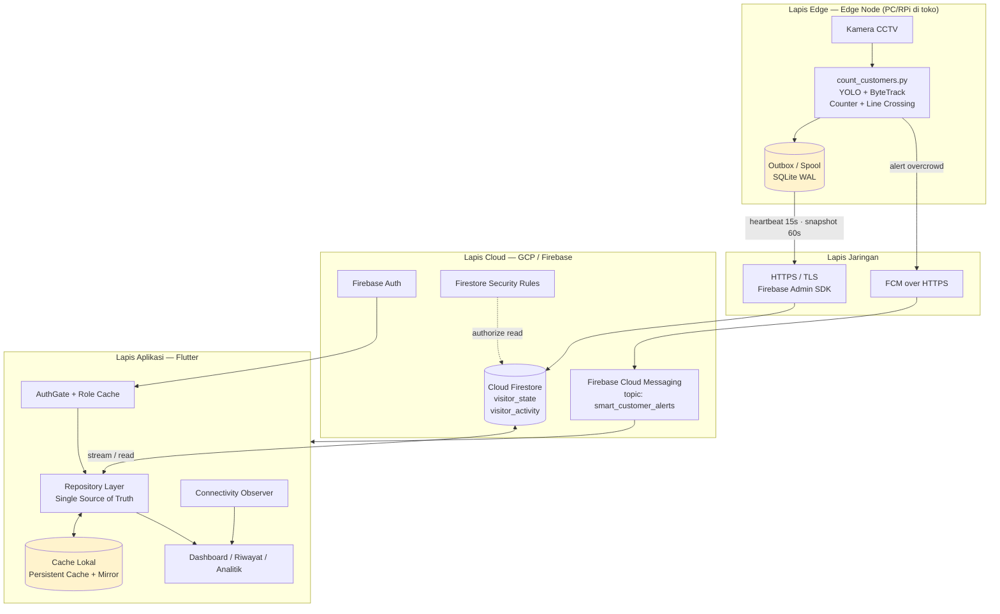
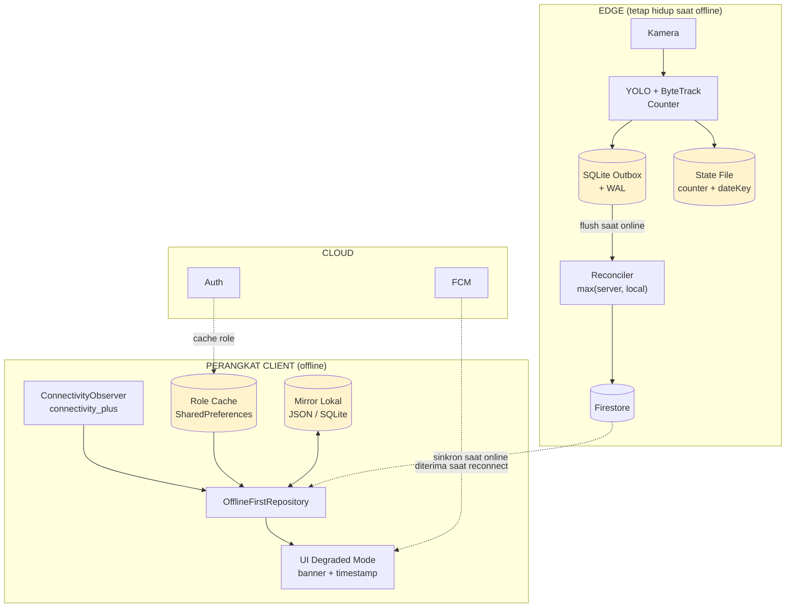
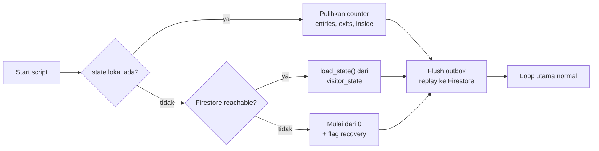
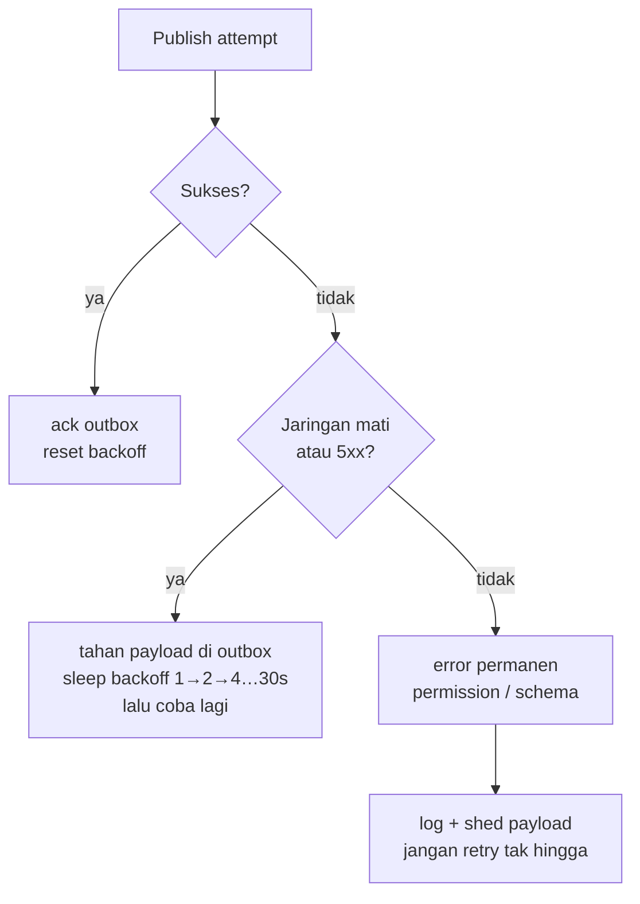
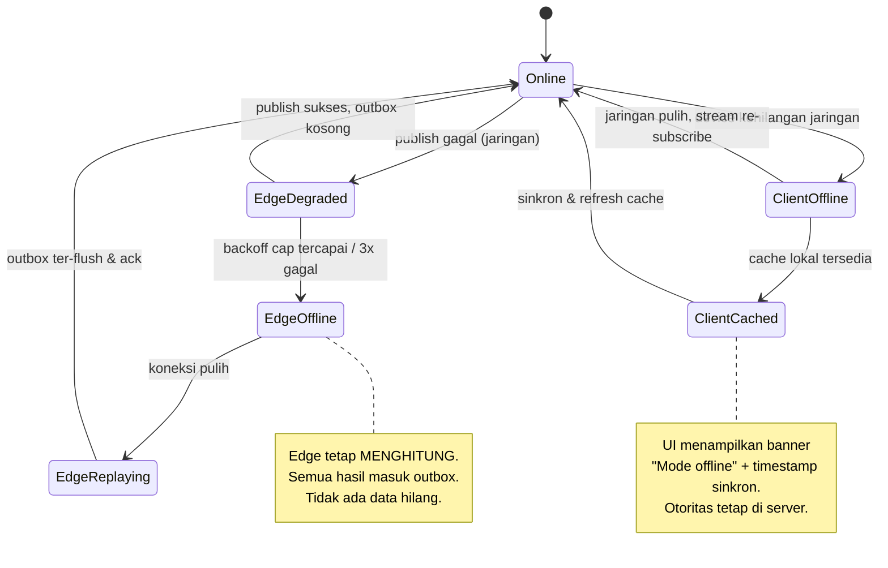
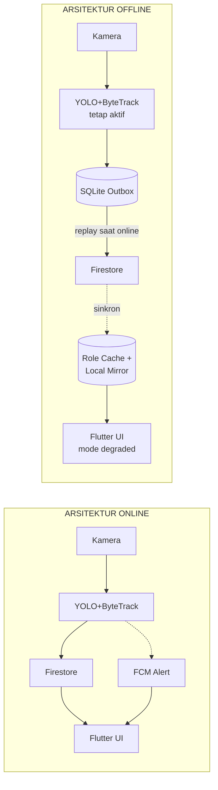

# Rancangan Arsitektur Smart Customer (UTS)

Dokumen ini merancang arsitektur **online** dan **offline** untuk proyek IoT
*Smart Customer* — pemantauan kepadatan pengunjung minimarket berbasis
YOLO/ByteTrack (edge), Cloud Firestore (cloud), dan Flutter (aplikasi).

---

## 1. Konteks dan Dasar Rancangan

### 1.1 Gambaran Umum Sistem

```text
Kamera → Edge (Python + OpenCV + YOLO/ByteTrack) → Cloud (Firestore) → Consumer (Flutter)
```

| Fungsi | Pelaku | Mekanisme |
|---|---|---|
| Sensing / Akuisisi | Kamera + script CV | Deteksi orang, crossing line |
| Edge Processing | `computer_vision/count_customers.py` | Hitung `totalMasuk`, `totalKeluar`, `jumlahDiDalam` |
| Integrasi / Transport | Firebase Admin SDK | Tulis state + snapshot ke Firestore, kirim FCM alert |
| Cloud / Storage | Cloud Firestore | `visitor_state`, `visitor_activity` |
| Security | Firestore Rules + Firebase Auth | Role `admin` / `operator` / `viewer` |
| Presentation | Flutter (Android/Web) | Dashboard, Riwayat, Analitik, Notifikasi |

### 1.2 Model 4 Lapisan IoT dan Pemetaannya

| Lapisan IoT | Komponen | Peran |
|---|---|---|
| **Perception** | Kamera, `count_customers.py` (YOLO + ByteTrack) | Mengamati dunia fisik → data agregat |
| **Network** | Firebase Admin SDK, FCM, Internet/Wi-Fi | Transport edge → cloud → user |
| **Processing** | Firestore + Security Rules | State durable, agregasi riwayat, otorisasi |
| **Application** | Flutter + FCM topic | Dashboard, analitik, notifikasi |

> Proyek ini memakai model *push-based* (edge mengirim aktif ke cloud). Konsekuensinya,
> saat uplink terputus edge tidak dapat mengirim — maka rancangan offline harus
> berfokus pada **(a) buffering di edge** dan **(b) caching di client**.

### 1.3 Aset Data (Data Contract)

Koleksi `visitor_state` dan `visitor_activity` berbagi skema field yang sama:

| Field | Tipe | Arti | Berlaku di |
|---|---|---|---|
| `cameraId` | string | ID stabil kamera | semua |
| `dateKey` | string | Tanggal lokal `YYYY-MM-DD` | state |
| `jumlahDiDalam` | int | Estimasi pengunjung di dalam | semua |
| `totalMasuk` | int | Total masuk hari ini (reset tengah malam) | state |
| `totalKeluar` | int | Total keluar hari ini | state |
| `maxCapacity` | int | Kapasitas toko | semua |
| `sensorOnline` | bool | Status kesehatan edge | semua |
| `updatedBy` | string | Penulis data (`yolo-python`) | semua |
| `schemaVersion` | int | Versi skema | semua |
| `timestamp` | Timestamp | `SERVER_TIMESTAMP` | semua |
| `isSnapshot` | bool | `true` untuk snapshot riwayat | snapshot saja |

Pola penulisan saat ini:

| Dokumen | Path | Jenis | Diterbitkan |
|---|---|---|---|
| State durable | `visitor_state/{cameraId}` | `set(merge=True)` | tiap publish |
| Live state | `visitor_activity/current_{cameraId}` | `set(merge=True)` | tiap publish |
| Snapshot | `visitor_activity/{autoId}` | `add()` | tiap `--snapshot-seconds` (60 s) |

**Invarian yang wajib dipertahankan pada mode offline:**

- Snapshot bersifat *append-only* → tidak ada konflik tulis, aman di-replay.
- Counter harian *monotonik* → saat flush, ambil `max(nilai_server, nilai_lokal)`
  agar tidak under-count.
- `timestamp` selalu dari **server** (`SERVER_TIMESTAMP`) — ini acuan freshness
  tunggal untuk seluruh sistem.

---

## 2. Arsitektur ONLINE

### 2.1 Diagram Arsitektur



### 2.2 Alur Data Online (Rantai Normal)

```mermaid
sequenceDiagram
    autonumber
    participant K as Kamera
    participant E as Edge CV
    participant O as Outbox
    participant F as Firestore
    participant R as Repository
    participant U as UI Flutter
    participant N as FCM

    K->>E: frame (30 fps)
    E->>E: deteksi + track + crossing line
    E->>E: hitung masuk/keluar (in-memory)
    E->>O: enqueue heartbeat (tiap 15s)
    E->>O: enqueue snapshot (tiap 60s)
    O->>F: set visitor_state + current_* (merge)
    O->>F: add snapshot (isSnapshot=true)
    O->>F: timestamp = SERVER_TIMESTAMP
    F-->>R: emit snapshot stream (push)
    R->>R: tulis mirror cache lokal
    R-->>U: Stream&lt;Snapshot&gt; (data + freshness)
    U->>U: render dashboard real-time
    E->>N: alert saat occupancy ≥ threshold
    N-->>U: notifikasi kepadatan (Android)
```

**Kunci:** Firestore `snapshots()` bersifat *push*. Aplikasi tidak pernah polling.

### 2.3 Komponen dan Tanggung Jawab

#### A. Edge Node — `computer_vision/count_customers.py`

| Tanggung jawab | Implementasi saat ini | Target online |
|---|---|---|
| Akuisisi & tracking | YOLO pose + ByteTrack, `classes=[0]` | tetap |
| Penghitungan | crossing line (`line_ratio`) | tetap |
| Heartbeat | `--publish-seconds 15` | tetap |
| Snapshot | `--snapshot-seconds 60` | tetap |
| Health signal | `sensorOnline` | tetap |
| **Spooling** | belum ada | **wajib** (lihat §3.3) |
| **Backoff** | retry per-frame | **exponential backoff** |
| **Watchdog** | belum ada | systemd unit agar auto-restart |

#### B. Cloud Layer

| Komponen | Peran |
|---|---|
| `visitor_state/{cameraId}` | State durable edge, sumber pemulihan saat restart |
| `visitor_activity/current_{cameraId}` | Live state, dibaca `RealtimeService.watchStats()` |
| `visitor_activity/{autoId}` | Snapshot append-only untuk riwayat & analitik |
| Firebase Auth | Identitas user |
| `users/{uid}.role` | Otorisasi berbasis peran |
| FCM topic | Notifikasi kepadatan |

#### C. Application Layer — Flutter

Saat ini service membaca Firestore langsung dari widget (`RealtimeService()`
dipanggil di dalam `State`). Rancangan online menuntut **repository layer**
sebagai perbaikan anti-pattern:

```dart
// lib/data/visitor_repository.dart  (target)
abstract class VisitorRepository {
  Stream<VisitorSnapshot> watchLive();
  Stream<List<HistoryEntry>> watchHistory();
  Stream<AnalyticsSummary> watchAnalytics();
  Future<void> refresh();
}

class FirestoreVisitorRepository implements VisitorRepository {
  FirestoreVisitorRepository({FirebaseFirestore? firestore})
      : _firestore = firestore ?? FirebaseFirestore.instance;

  final FirebaseFirestore _firestore;
  // mapping QuerySnapshot -> domain model
}
```

Alasan repository layer untuk mode online:

1. **Single source of truth** → UI tidak pernah tahu Firestore.
2. **Testability** → repository dapat di-*fake* saat unit test.
3. **Offline-first** → repository sama bisa di-*backend swap* ke cache lokal (§3.4).
4. **Mapping domain** → `ApiService` dan `RealtimeService` kini parses field yang
   sama (`jumlahDiDalam`, `timestamp`, `maxCapacity`) secara duplikat; disatukan.

#### D. Konfigurasi Persistence Wajib

`main.dart` saat ini hanya `Firebase.initializeApp()`. Untuk online mode yang andal:

```dart
// lib/main.dart (target)
await Firebase.initializeApp(options: DefaultFirebaseOptions.currentPlatform);

if (!kIsWeb) {
  final firestore = FirebaseFirestore.instance;
  firestore.settings = const Settings(
    persistenceEnabled: true,          // bertahan melewati restart aplikasi
    cacheSizeBytes: Settings.CACHE_SIZE_UNLIMITED,
  );
}
```

> Pada **web**, cache Firestore hanya hidup di memori dan hilang saat tab ditutup.
> Untuk web dibutuhkan *mirror* lokal sendiri (§3.4).

### 2.4 Kontrak Akses Data

| Operation | Path | Method | Rules |
|---|---|---|---|
| Read live | `visitor_activity` | `orderBy('timestamp', desc).limit(1)` | read allowed |
| Read chart | `visitor_activity` | `orderBy('timestamp', desc).limit(24)` | read allowed |
| Read history | `visitor_activity` | `orderBy('timestamp', desc).limit(500)`, skip `current_*` | read allowed |
| Read role | `users/{uid}` | `get()` | own doc only |
| Write state | `visitor_state/{cameraId}` | Admin SDK | client: **deny** |
| Write activity | `visitor_activity/*` | Admin SDK | client: **deny** |

`firestore.rules` saat ini sudah tepat untuk mode online: **client read-only**,
penulisan hanya lewat Admin SDK (server-to-server, bypass rules). Praktik ini
harus dipertahankan, dan di mode offline menjadi **wajib**, karena tidak ada
jalur tulis yang sah dari perangkat.

### 2.5 Kualitas Layanan (QoS) Online

| Metrik | Target | Cara Ukur |
|---|---|---|
| Latensi heartbeat → dashboard | < 3 s | `timestamp` server − timestamp edge |
| Frekuensi heartbeat | 15 s | `--publish-seconds` |
| Frekuensi snapshot | 60 s | `--snapshot-seconds` |
| Ketersediaan dashboard | 99% | reconnect otomatis stream |
| Batas record history | 500 | `ApiService._maxRecords` |
| Retensi data | 90 hari | Firestore TTL policy (target) |
| Keterlambatan notifikasi | < 10 s | FCM delivery |

---

## 3. Arsitektur OFFLINE

### 3.1 Konteks: Tiga Makna "Offline"

Istilah "offline" pada proyek ini punya **tiga makna berbeda**, dan masing-masing
butuh solusi berbeda. Inilah inti rancangan UTS ini.

| # | Skenario | Gejala di Proyek Saat Ini | Solusi Utama |
|---|---|---|---|
| **O1** | **Edge offline** — kamera & CV hidup, uplink Internet putus | `Firestore publish failed; will retry` | Outbox/spool lokal + backoff + replay |
| **O2** | **Client offline** — HP/PC tanpa Internet | Dashboard kosong / "Gagal memuat riwayat" | Cache persisten + mirror lokal + UI degraded |
| **O3** | **Cloud offline** — layanan Firebase tidak dapat/unavailable | Stream error di semua halaman | Retry berjenjang + last-known-good + circuit breaker |

### 3.2 Diagram Arsitektur Offline Keseluruhan



### 3.3 O1 — Edge Offline: Outbox + Backoff

#### Masalah

Pada `count_customers.py` saat ini, ketika publish gagal:

```python
except Exception as exc:
    print(f"Firestore publish failed; will retry: {exc}", file=sys.stderr)
    last_publish = now          # retry berikutnya = publish_seconds kemudian
```

Counter `entries` / `exits` / `current_inside` **hanya hidup di RAM**. Dampak:

1. **Restart saat offline** → `load_state()` memulihkan nilai **terakhir yang sukses
   terkirim**. Exit yang tercatat selama outage hilang, tetapi occupancy server
   masih menyebut orang "di dalam" → **occupancy bergeser permanen**.
2. **Retry tanpa jeda** → `count_changed` sengaja dibiarkan `True`, sehingga
   publisher mencoba **setiap frame** (~30×/detik) selama outage → error flood.

#### Solusi: Local Outbox (Transactional Outbox Pattern)

```python
# computer_vision/publisher.py  (target)
class FirestorePublisher:
    def __init__(self, db, camera_id, max_capacity, snapshot_seconds, spool_path):
        self.db = db
        self.state_ref = db.collection("visitor_state").document(camera_id)
        self.activity_collection = db.collection("visitor_activity")
        self.current_ref = self.activity_collection.document(f"current_{camera_id}")
        self.spool = Outbox(spool_path)      # sqlite3, WAL mode
        self.snapshot_seconds = snapshot_seconds
        self.last_snapshot_at = 0.0
        self.backoff = 1.0                    # mulai 1 detik

    def publish(self, entries, exits, current_inside, *, sensor_online, force_snapshot=False):
        payload = {
            "cameraId": self.camera_id,
            "dateKey": local_date_key(),
            "jumlahDiDalam": max(0, current_inside),
            "totalMasuk": max(0, entries),
            "totalKeluar": max(0, exits),
            "maxCapacity": self.max_capacity,
            "sensorOnline": sensor_online,
            "updatedBy": "yolo-python",
            "schemaVersion": 1,
        }
        # 1) Tulis ke outbox lokal DULU (durable, WAL)
        self.spool.enqueue("heartbeat", payload, self.camera_id)
        # 2) Coba kirim sekarang; bila gagal, payload tetap aman di outbox
        self._flush_outbox()

    def _flush_outbox(self):
        for item in self.spool.peek(limit=50):
            try:
                if item.kind == "heartbeat":
                    body = item.payload | {"timestamp": firestore.SERVER_TIMESTAMP}
                    self.state_ref.set(body, merge=True)
                    self.current_ref.set(body, merge=True)
                else:  # snapshot
                    self.activity_collection.add(item.payload | {
                        "timestamp": firestore.SERVER_TIMESTAMP,
                        "isSnapshot": True,
                    })
                self.spool.ack(item.id)
                self.backoff = 1.0            # reset backoff setelah sukses
            except Exception as exc:
                print(f"Publish failed, retry in {self.backoff:.0f}s: {exc}", file=sys.stderr)
                self.backoff = min(self.backoff * 2, 30.0)   # exponential, cap 30s
                break                          # stop di item pertama agar urutan terjaga
```

Skema tabel outbox:

```sql
CREATE TABLE outbox (
  id         INTEGER PRIMARY KEY AUTOINCREMENT,
  kind       TEXT    NOT NULL,     -- 'heartbeat' | 'snapshot'
  camera_id  TEXT    NOT NULL,
  payload    TEXT    NOT NULL,     -- JSON
  created_at REAL    NOT NULL
);
-- mode WAL: tahan crash / power loss di tengah proses
```

**Aturan rekonsiliasi saat flush (mencegah under-count):**

```python
# Anti under-count: server lebih besar → pertahankan yang lebih besar.
# Snapshot bersifat append-only sehingga tidak pernah bentrok dan aman di-replay.
server = self.state_ref.get().to_dict() or {}
merged_entries = max(server.get("totalMasuk", 0), item.payload["totalMasuk"])
merged_exits   = max(server.get("totalKeluar", 0), item.payload["totalKeluar"])
```

#### State File Lokal (survive restart)

```python
# computer_vision/state_store.py  (target) — JSON atomic write
def save_local_state(path, entries, exits, current_inside, date_key):
    tmp = path.with_suffix(".tmp")
    tmp.write_text(json.dumps({
        "totalMasuk": entries, "totalKeluar": exits,
        "jumlahDiDalam": current_inside, "dateKey": date_key,
        "schemaVersion": 1,
    }))
    tmp.replace(path)          # atomic rename → tidak ada file setengah tertulis
```

Urutan pemulihan saat start:



**Konsekuensi:** hitungan yang terjadi saat outage **tidak hilang** — saat uplink
pulih, outbox di-replay dan counter akhir menjadi `max(server, lokal)`.

### 3.4 O2 — Client Offline: Cache, Mirror, dan AuthGate

#### Masalah 1 — `AuthGate` memblokir seluruh aplikasi

`_RoleGate` melakukan `get()` **sekali jalan** ke `users/{uid}`:

```dart
final roleDocument = FirebaseFirestore.instance.collection('users').doc(user.uid).get();
```

Saat offline, `get()` **gagal** (bukan dilayani cache) → `snapshot.hasError` →
layar "Tidak dapat memverifikasi akses" → **user terkunci keluar dari aplikasi**,
padahal yang terjadi hanya koneksi putus.

#### Perbaikan: Role Cache + Streaming

```dart
// lib/auth/role_cache.dart  (target)
class RoleCache {
  static String keyFor(String uid) => 'last_known_role:$uid';

  static Future<void> save(String uid, String role) async {
    final prefs = await SharedPreferences.getInstance();
    await prefs.setString(keyFor(uid), role);
  }

  static Future<String?> read(String uid) async {
    final prefs = await SharedPreferences.getInstance();
    return prefs.getString(keyFor(uid));
  }
}
```

```dart
// lib/auth/auth_gate.dart  (target)
class _RoleGate extends StatelessWidget {
  Widget build(BuildContext context) {
    return StreamBuilder<DocumentSnapshot<Map<String, dynamic>>>(
      // snapshots() (bukan get()) → dilayani cache saat offline, dan
      // otomatis live-update begitu koneksi pulih.
      stream: FirebaseFirestore.instance
          .collection('users')
          .doc(user.uid)
          .snapshots(includeMetadataChanges: true),
      builder: (context, snapshot) {
        final role = snapshot.data?.data()?['role'];
        const allowedRoles = {'admin', 'operator', 'viewer'};

        if (role is String && allowedRoles.contains(role)) {
          RoleCache.save(user.uid, role);      // refresh cache saat online
          return child;
        }

        // Offline / dokumen belum ter-cache → pakai cache lokal.
        if (snapshot.hasError || snapshot.connectionState == ConnectionState.waiting) {
          return FutureBuilder<String?>(
            future: RoleCache.read(user.uid),
            builder: (context, cached) {
              final c = cached.data;
              if (c != null && allowedRoles.contains(c)) {
                return child;   // akses dari cache, disertai banner "Mode offline"
              }
              return const _AccessMessage(
                title: 'Tidak dapat memverifikasi akses',
                message: 'Periksa koneksi internet dan aturan Firestore.',
                showSignOut: true,
              );
            },
          );
        }
        return const _AccessMessage(/* belum diberi akses */);
      },
    );
  }
}
```

> Catatan keamanan: cache role bersifat **lokal dan bisa dimanipulasi**. Karena
> Firestore Rules tetap menjadi otoritas server-side, keputusan akses final
> tetap ditegakkan di server — cache hanya mencegah UX terblokir saat offline.

#### Masalah 2 — Riwayat & Analitik tidak memberi tahu data basi

`ApiService` memakai `.snapshots()` **tanpa** `includeMetadataChanges: true`,
sehingga `metadata.isFromCache` tidak pernah diekspos.

```dart
// lib/services/api_service.dart  (target)
Stream<List<CustomerEvent>> watchHistory() {
  return _collection
      .orderBy('timestamp', descending: true)
      .limit(_maxRecords)
      .snapshots(includeMetadataChanges: true)   // <-- expose metadata
      .map((snapshot) {
    final records = _recordsFrom(snapshot);
    return records.map((r) => CustomerEvent(
      time: _formatHistoryTime(r.timestamp),
      customersInside: r.customersInside,
      densityStatus: r.densityStatus,
    )).toList(growable: false);
  });
}
```

Agar metadata sampai ke UI, bungkus di domain model:

```dart
class HistoryFeed {
  final List<CustomerEvent> events;
  final bool isFromCache;      // true → data basi
  final DateTime? lastSyncedAt;
}
```

#### Masalah 3 — Web kehilangan cache saat tab ditutup

| Platform | Firestore persistent cache | Mirror lokal kustom |
|---|---|---|
| Android | aktif (SQLite) | opsional |
| iOS | aktif (SQLite) | opsional |
| Web | **tidak** (memori; IndexedDB opsional) | **wajib** |

Karena itu, di web `ApiService` dan `RealtimeService` tidak boleh menjadi satu-satunya
sumber data; butuh *mirror* JSON/IndexedDB yang ditulis setiap kali stream emit.

#### Mirror Lokal

```dart
// lib/data/local_mirror.dart  (target)
class LocalMirror {
  static const _key = 'visitor_mirror';

  static Future<void> write(VisitorSnapshot s) async {
    final prefs = await SharedPreferences.getInstance();
    await prefs.setString(_key, jsonEncode(s.toJson()));
  }

  static Future<VisitorSnapshot?> read() async {
    final prefs = await SharedPreferences.getInstance();
    final raw = prefs.getString(_key);
    if (raw == null) return null;
    return VisitorSnapshot.fromJson(jsonDecode(raw));
  }
}
```

#### Perbandingan Perilaku UI

| Halaman | Online | Offline (target) |
|---|---|---|
| Dashboard | Data real-time, badge `LIVE` | Data cache, badge `OFFLINE` + "Terakhir sinkron 14:32" |
| Riwayat | Snapshot terbaru | Snapshot cache, banner "Menampilkan data cache (N data)" |
| Analitik | Ringkasan terhitung | Ringkasan terhitung dari cache + label basi |
| Login | Login via Auth | Cache role; session valid → langsung masuk |
| Notifikasi | FCM real-time | Terlambat (diterima saat reconnect) |

### 3.5 O3 — Cloud Offline: Retry Berjenjang + Circuit Breaker

```python
# computer_vision/backoff.py  (target)
class Backoff:
    def __init__(self, base=1.0, cap=30.0, factor=2.0):
        self.base, self.cap, self.factor = base, cap, factor
        self.current = base

    def next_delay(self) -> float:
        delay = self.current
        self.current = min(self.current * self.factor, self.cap)
        return delay

    def reset(self) -> None:
        self.current = self.base
```

Urutan penanganan error:



**Circuit breaker**: setelah N kegagalan berturut-turut, jeda seluruh attempt
selama `cooldown` (mis. 60 s), sambil tetap menulis ke outbox lokal sehingga
tidak ada data yang hilang.

### 3.6 State Machine Konektivitas



### 3.7 Matriks Degradasi

| Komponen | Normal | Edge offline (O1) | Client offline (O2) | Cloud offline (O3) |
|---|---|---|---|---|
| Kamera + CV | aktif | **aktif** | aktif (edge bebas) | aktif |
| Penghitungan | real-time | **real-time, lokal** | real-time, lokal | real-time, lokal |
| Penyimpanan counter | RAM + Firestore | RAM + **outbox + state file** | RAM + Firestore | RAM + outbox |
| Publish ke Firestore | 15 s | tertunda, di-replay | 15 s | gagal, retry/backoff |
| Dashboard | live | live | **cache** | **cache** |
| Riwayat/Analitik | live | live | cache + label basi | cache + label basi |
| Notifikasi FCM | < 10 s | **tertunda** | **tertunda** | tertunda |
| Auth/role | live | live | **role cache** | role cache |
| Data hilang | 0 | **0** (outbox) | 0 | 0 |

### 3.8 Perbandingan Arsitektur Online vs Offline

| Aspek | Arsitektur Online | Arsitektur Offline |
|---|---|---|
| Sumber kebenaran | Firestore (server) | Edge = primer saat putus; Firestore saat online |
| Model penulisan | push langsung, tanpa antrean | transactional outbox, replay saat pulih |
| Arah data | edge → cloud → client | edge → outbox → cloud (buffered) |
| Pembacaan client | Firestore stream | Firestore stream, fallback cache/mirror |
| Handling error | retry | retry + backoff + circuit breaker + buffer |
| State di edge | RAM saja | RAM + file state + SQLite WAL |
| Otorisasi | Rules di server | Rules tetap di server; cache role hanya UX |
| Badge status | `LIVE` | `OFFLINE` / `TERTUNDA` + timestamp sinkron |
| Failure window | data < 15 s hilang | **tidak ada data hilang** |
| Kompleksitas | rendah | menengah-tinggi |

---

## 4. Peta Modifikasi File

### 4.1 Edge — `computer_vision/`

| File | Aksi | Rasional |
|---|---|---|
| `publisher.py` | **BARU** — Extract `FirestorePublisher` + `Outbox` (SQLite) | Pisahkan concern sinkronisasi dari loop deteksi |
| `state_store.py` | **BARU** — state lokal JSON atomic write | Survive restart saat offline |
| `backoff.py` | **BARU** — `Backoff` class | Exponential backoff, cap 30 s |
| `count_customers.py` | **MODIFIKASI** — pakai `Outbox`, `Backoff`, `StateStore`; hapus retry per-frame | Hilangkan error flood & data loss |
| `requirements.txt` | **MODIFIKASI** — `sqlite3` sudah bawaan Python; tidak perlu dependensi baru | — |

### 4.2 Flutter — `lib/`

| File | Aksi | Rasional |
|---|---|---|
| `main.dart` | **MODIFIKASI** — `firestore.settings` persistence, init `ConnectivityObserver` | Persistent cache + deteksi konektivitas |
| `data/visitor_repository.dart` | **BARU** — abstraksi repository | Single source of truth, injectable |
| `data/local_mirror.dart` | **BARU** — mirror JSON/SharedPreferences | Wajib untuk web |
| `auth/role_cache.dart` | **BARU** — cache role via SharedPreferences | Cegah user terkunci saat offline |
| `auth/auth_gate.dart` | **MODIFIKASI** — `get()` → `snapshots()`, fallback RoleCache | Offline tidak lagi memblokir |
| `services/api_service.dart` | **MODIFIKASI** — `includeMetadataChanges: true`, expose `isFromCache` | UI bisa memberi tahu data basi |
| `services/realtime_service.dart` | **MODIFIKASI** — map ke domain model `VisitorSnapshot` | Konsistensi antar service |
| `models/customer_stats.dart` | **MODIFIKASI** — tambah `lastSyncedAt`, `source` enum | Representasi freshness eksplisit |
| `widgets/offline_banner.dart` | **BARU** — banner "Mode offline" | Honesty pada UI |
| `pubspec.yaml` | **MODIFIKASI** — `connectivity_plus`, `shared_preferences` | Konektivitas & cache lokal |

### 4.3 Cloud

| File | Aksi | Rasional |
|---|---|---|
| `firestore.rules` | **TIDAK BERUBAH** | Client read-only sudah benar & wajib |
| `firestore.indexes.json` | **TIDAK BERUBAH** | Query `orderBy('timestamp')` pada 1 field tidak butuh composite index |

---

## 5. Implementasi Bertahap

| Tahap | Deliverable | Uji Verifikasi | Estimasi |
|---|---|---|---|
| **T1** | `Backoff` + hapus retry per-frame | Matikan Wi-Fi 60 s → cek log: error rate turun, tidak spam | 1 jam |
| **T2** | `Outbox` SQLite + `StateStore` | Matikan Wi-Fi 5 mnt, hitung 3 orang masuk/2 keluar, nyalakan Wi-Fi → counter final benar | 3 jam |
| **T3** | `RoleCache` + `AuthGate` streaming | Matikan Wi-Fi di HP → app tetap masuk (mode offline) | 2 jam |
| **T4** | `includeMetadataChanges` + `OfflineBanner` | Matikan Wi-Fi → Riwayat/Analitik tampil banner "data basi" | 2 jam |
| **T5** | `Repository` + `LocalMirror` | Refresh halaman saat offline → data tetap tampil | 4 jam |
| **T6** | `connectivity_plus` + badge kontekstual | Toggle airplane mode → badge berubah LIVE/OFFLINE | 2 jam |
| **T7** | Watchdog (systemd) + TTL policy | Kill proses → auto-restart, state pulih | 3 jam |

---

## 6. Skenario Uji (Uji UTS)

| ID | Skenario | Prosedur | Expected Result |
|---|---|---|---|
| **U1** | Normal online | Jalankan CV + app | Dashboard `LIVE`, data sesuai hitungan manual |
| **U2** | Edge offline singkat | Cabut Wi-Fi 2 menit | Edge tetap menghitung; log "Publish failed, retry in Ns"; tidak ada error flood |
| **U3** | Edge offline panjang + replay | Cabut Wi-Fi 10 menit, 5 orang masuk 3 keluar; nyalakan Wi-Fi | Setelah flush: `totalMasuk` naik 5, `totalKeluar` naik 3, occupancy konsisten |
| **U4** | Edge restart saat offline | Cabut Wi-Fi, `Ctrl+C`, jalankan ulang | Counter pulih dari state file lokal, bukan dari nol |
| **U5** | Client offline | Matikan data HP, buka app | Dashboard tampil data cache + badge `OFFLINE` + "terakhir sinkron" |
| **U6** | AuthGate offline | Matikan data HP, buka app yang sudah login | Tidak terjebak di "Tidak dapat memverifikasi akses" |
| **U7** | Web reload offline | Buka web, matikan Wi-Fi, refresh | Data tetap tampil dari mirror lokal |
| **U8** | Pemulihan | Nyalakan jaringan kembali | Stream reconnect otomatis; badge kembali `LIVE`; cache di-refresh |
| **U9** | Sensor mati | Tutup kamera / hentikan script | `sensorOnline=false` → badge `TERTUNDA` setelah 5 menit |
| **U10** | Beban tinggi | 50+ orang masuk bersamaan | Counter akurat, snapshot tetap 60 s, tidak ada data hilang |

---

## 7. Kesimpulan

**Arsitektur online** proyek Smart Customer sudah cukup baik: model push-based,
state durable terpisah dari snapshot append-only, client read-only dengan
Firestore Rules, dan FCM untuk alerting. Yang perlu diperkuat adalah
**layering** (repository) dan **konfigurasi persistence** yang eksplisit.

**Arsitektur offline** adalah kelemahan utama proyek saat ini, dan terbagi tiga:

1. **Edge offline** — counter hilang saat outage/restart, dan retry membanjiri
   Firestore. Diperbaiki dengan *transactional outbox* (SQLite WAL) +
   *exponential backoff* + *state file* lokal, dengan rekonsiliasi
   `max(server, lokal)` agar tidak under-count.
2. **Client offline** — `AuthGate` yang berbasis `get()` sekali jalan
   unresponsive/memblokir seluruh aplikasi saat offline; riwayat & analitik
   tidak menandai data basi; web kehilangan cache. Diperbaiki dengan *role
   cache* + `snapshots()` streaming, `includeMetadataChanges`, *local mirror*,
   dan UI degraded mode.
3. **Cloud offline** — perlu retry berjenjang dan circuit breaker agar error
   tidak berulang tanpa henti.

Prinsip yang dipakai di seluruh rancangan: **data agregat never hilang** —
entah karena outage edge (outbox), outage client (cache), atau outage cloud
(backoff + buffering) — dan **kebenaran tetap ditegakkan di server** melalui
Firestore Rules, dengan cache lokal hanya berfungsi sebagai memori UI, bukan untuk
otorisasi.

---

## Lampiran A — Ringkasan Arsitektur dalam Satu Gambar



## Lampiran B — Daftar Istilah

| Istilah | Pengertian |
|---|---|
| **Edge** | Node komputasi di dekat sumber data (PC/RPi yang menjalankan CV) |
| **Outbox** | Antrean lokal yang tahan crash untuk penulisan keluar |
| **WAL** | Write-Ahead Log — mode SQLite yang menjaga integritas data saat crash |
| **Backoff** | Menunda percobaan ulang dengan interval yang meningkat |
| **Circuit breaker** | Menghentikan attempt sementara saat layanan terus gagal |
| **Snapshot** | Catatan status point-in-time untuk riwayat, append-only |
| **Freshness / staleness** | Seberapa baru data terhadap `timestamp` server |
| **Degraded mode** | Mode operasi terbatas saat sistem tidak dapat bekerja normal |
| **Push-based** | Data dikirim dari sumber ke sink tanpa polling |

