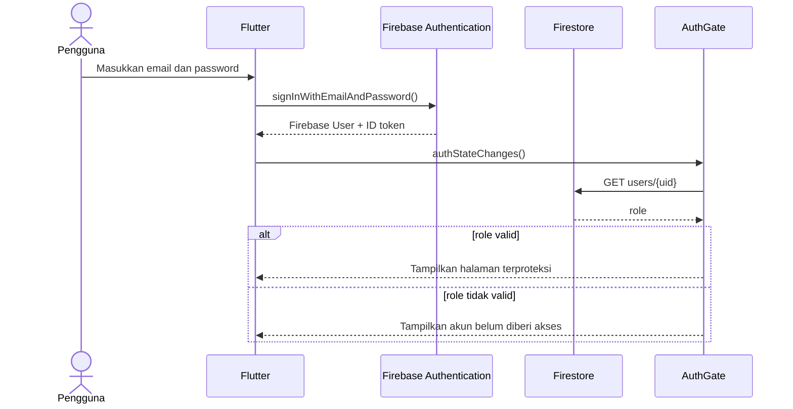
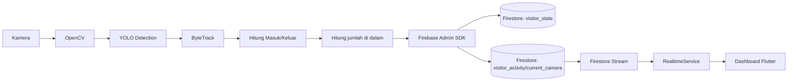
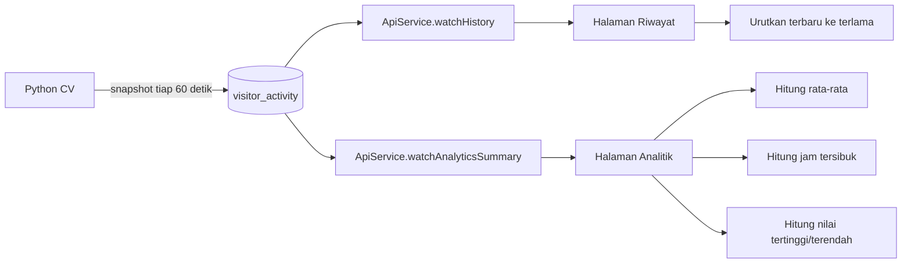
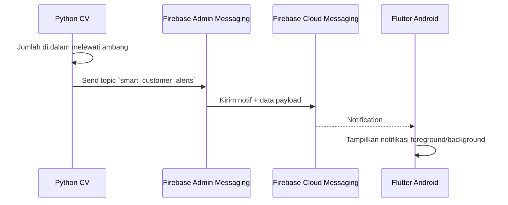

# Rancangan Endpoint, JSON, dan Alur Data - Smart Customer

## 1. Ringkasan

Smart Customer saat ini menggunakan **Firebase Authentication** untuk login dan **Cloud Firestore** sebagai database real-time. Program Python/Computer Vision menulis data agregat melalui Firebase Admin SDK, sedangkan aplikasi Flutter membaca data memakai Cloud Firestore SDK.

Pada implementasi saat ini, belum ada REST API HTTP yang dijalankan aplikasi. Oleh karena itu, dokumen ini membedakan:

- **Kontrak data Firebase aktual**: koleksi dan field yang benar-benar digunakan sekarang.
- **Rancangan REST API konseptual**: endpoint yang dapat ditambahkan sebagai lapisan backend tanpa mengubah arsitektur inti.

## 2. Aktor Sistem

| Aktor | Peran |
|---|---|
| Pengunjung | Orang yang dihitung oleh sistem kamera |
| Camera/CV Service | Python, YOLO, OpenCV, dan ByteTrack |
| Firebase Admin SDK | Menulis kondisi dan snapshot secara tepercaya |
| Cloud Firestore | Penyimpanan kondisi terkini dan riwayat |
| Firebase Authentication | Memvalidasi identitas pengguna |
| Flutter Client | Dashboard, Analitik, Riwayat, dan Pengaturan |
| FCM | Mengirim notifikasi ambang kepadatan |

## 3. Kontrak Data Firebase Saat Ini

### 3.1 `users/{uid}`

Dokumen peran milik pengguna.

```json
{
  "role": "viewer"
}
```

Nilai `role` yang diterima:

- `admin`
- `operator`
- `viewer`

Aturan:

- Pengguna hanya dapat membaca dokumen perannya sendiri.
- Perubahan role tidak dapat dilakukan dari Flutter dan harus dilakukan secara tepercaya oleh administrator.

### 3.2 `visitor_activity/current_{cameraId}`

Dokumen kondisi terkini. Flutter memperbarui dashboard melalui stream Firestore.

```json
{
  "cameraId": "minimarket-main",
  "dateKey": "2026-11-19",
  "timestamp": "2026-11-19T09:30:15+07:00",
  "jumlahDiDalam": 6,
  "totalMasuk": 42,
  "totalKeluar": 36,
  "maxCapacity": 40,
  "sensorOnline": true,
  "updatedBy": "yolo-python",
  "schemaVersion": 1
}
```

Penjelasan field:

| Field | Tipe | Keterangan |
|---|---|---|
| `cameraId` | string | ID logis kamera |
| `dateKey` | string | Tanggal lokal dalam format `YYYY-MM-DD` |
| `timestamp` | Firestore Timestamp | Waktu pembaruan server |
| `jumlahDiDalam` | integer | Estimasi jumlah pengunjung di dalam |
| `totalMasuk` | integer | Total masuk pada hari lokal aktif |
| `totalKeluar` | integer | Total keluar pada hari lokal aktif |
| `maxCapacity` | integer | Kapasitas maksimal minimarket |
| `sensorOnline` | boolean | Status sensor/CV |
| `isSnapshot` | boolean | `true` hanya pada dokumen riwayat |

### 3.3 Snapshot historis

Dokumen baru ditulis ke koleksi `visitor_activity` secara berkala.

```json
{
  "cameraId": "minimarket-main",
  "dateKey": "2026-11-19",
  "timestamp": "2026-11-19T09:30:15+07:00",
  "jumlahDiDalam": 6,
  "totalMasuk": 42,
  "totalKeluar": 36,
  "maxCapacity": 40,
  "sensorOnline": true,
  "isSnapshot": true,
  "updatedBy": "yolo-python",
  "schemaVersion": 1
}
```

Dokumen yang ID-nya diawali `current_` tidak dihitung sebagai riwayat. Contoh lama tanpa `isSnapshot` masih diterima untuk kompatibilitas, kecuali `isSnapshot=false`.

### 3.4 `visitor_state/{cameraId}`

State penghitung yang digunakan Python agar penghitung masuk/keluar dapat dipulihkan setelah proses dimulai ulang.

```json
{
  "cameraId": "minimarket-main",
  "dateKey": "2026-11-19",
  "timestamp": "2026-11-19T09:30:15+07:00",
  "jumlahDiDalam": 6,
  "totalMasuk": 42,
  "totalKeluar": 36,
  "maxCapacity": 40,
  "sensorOnline": true,
  "updatedBy": "yolo-python",
  "schemaVersion": 1
}
```

## 4. Rancangan REST Endpoint

REST endpoint berikut adalah **lapisan konseptual**. Implementasi dapat dilakukan dengan Firebase Cloud Functions atau layanan backend lain. Penulisan saat ini tetap sebaiknya dilakukan oleh server/admin SDK, bukan pengguna Flutter.

### 4.1 Autentikasi

| Endpoint | Method | Akses | Fungsi |
|---|---|---|---|
| `/auth/session` | `POST` | Publik | Bertukar Firebase ID token menjadi sesi backend |
| `/auth/logout` | `POST` | Autentikasi | Mengakhiri sesi aplikasi |
| `/users/me` | `GET` | Autentikasi | Mengambil profil dan role pengguna |

Pada implementasi Flutter saat ini, login langsung memakai Firebase Auth SDK; password tidak dikirim ke Firestore atau endpoint REST. Untuk REST, kirim Firebase ID token pada header:

```text
Authorization: Bearer <firebase-id-token>
```

Contoh respons `/users/me`:

```json
{
  "uid": "g82GxZ0...",
  "email": "operator@example.com",
  "role": "operator"
}
```

### 4.2 Kondisi Kamera

| Endpoint | Method | Akses | Fungsi |
|---|---|---|---|
| `/cameras` | `GET` | `admin`, `operator`, `viewer` | Daftar kamera |
| `/cameras/{cameraId}/current` | `GET` | `admin`, `operator`, `viewer` | Kondisi terkini |
| `/cameras/{cameraId}/stream` | `GET`/WebSocket | `admin`, `operator`, `viewer` | Pembaruan real-time |

Contoh `GET /cameras/minimarket-main/current`:

```json
{
  "cameraId": "minimarket-main",
  "jumlahDiDalam": 6,
  "totalMasuk": 42,
  "totalKeluar": 36,
  "maxCapacity": 40,
  "sensorOnline": true,
  "statusKepadatan": "NORMAL",
  "persentaseKapasitas": 15,
  "timestamp": "2026-11-19T09:30:15+07:00",
  "dataSource": "firestore",
  "isStale": false
}
```

Status kepadatan UI saat ini:

| Kondisi | Aturan |
|---|---|
| `SEPI` | `jumlahDiDalam <= 1` |
| `NORMAL` | `2 <= jumlahDiDalam <= 3` |
| `RAMAI` | `jumlahDiDalam > 3` |

Catatan: rancangan analitik berbasis rasio membagi jumlah pengunjung dengan kapasitas. Aturan kepadatan sebaiknya disatukan agar dashboard dan riwayat tidak memiliki perbedaan hasil.

### 4.3 Riwayat dan Analitik

| Endpoint | Method | Akses | Fungsi |
|---|---|---|---|
| `/cameras/{cameraId}/history` | `GET` | `admin`, `operator`, `viewer` | Mengambil snapshot |
| `/cameras/{cameraId}/analytics/summary` | `GET` | `admin`, `operator`, `viewer` | Ringkasan analitik |

Contoh query:

```text
GET /cameras/minimarket-main/history?limit=500&start=2026-11-19T00:00:00+07:00
```

Contoh respons:

```json
{
  "cameraId": "minimarket-main",
  "items": [
    {
      "snapshotId": "abc123",
      "timestamp": "2026-11-19T09:30:15+07:00",
      "jumlahDiDalam": 6,
      "densityStatus": "NORMAL"
    },
    {
      "snapshotId": "abc124",
      "timestamp": "2026-11-19T09:31:15+07:00",
      "jumlahDiDalam": 8,
      "densityStatus": "SANGAT RAMAI"
    }
  ],
  "pagination": {
    "limit": 500,
    "nextCursor": null
  }
}
```

Contoh `/analytics/summary`:

```json
{
  "cameraId": "minimarket-main",
  "period": {
    "from": "2026-11-19T00:00:00+07:00",
    "to": "2026-11-19T23:59:59+07:00"
  },
  "averageVisitors": 6,
  "busiestHour": "09:00 - 10:00",
  "highestVisitors": 12,
  "lowestVisitors": 1,
  "sampleCount": 500
}
```

### 4.4 Entri dan Konfigurasi Sistem

| Endpoint | Method | Akses | Fungsi |
|---|---|---|---|
| `/cv/cameras/{cameraId}/publish` | `POST` | Service account/CV | Menulis kondisi terkini dan snapshot |
| `/cameras/{cameraId}/config` | `GET` | `admin`, `operator`, `viewer` | Membaca konfigurasi |
| `/cameras/{cameraId}/config` | `PATCH` | `admin` | Mengubah kapasitas dan ambang |
| `/notifications/crowd-alert/test` | `POST` | `admin` | Menguji notifikasi FCM |

Contoh payload CV:

```json
{
  "cameraId": "minimarket-main",
  "jumlahDiDalam": 6,
  "totalMasuk": 42,
  "totalKeluar": 36,
  "maxCapacity": 40,
  "sensorOnline": true,
  "forceSnapshot": false,
  "publishedAt": "2026-11-19T09:30:15+07:00"
}
```

### 4.5 Format Respons Galat

```json
{
  "error": {
    "code": "FORBIDDEN",
    "message": "Role pengguna tidak memiliki izin untuk operasi ini.",
    "requestId": "req_123456"
  }
}
```

Status HTTP yang digunakan:

| HTTP | Makna |
|---|---|
| `200` | Permintaan berhasil |
| `201` | Data baru berhasil dibuat |
| `400` | Payload atau parameter tidak valid |
| `401` | Token tidak ada atau tidak valid |
| `403` | Pengguna tidak memiliki role/izin |
| `404` | Kamera atau data tidak ditemukan |
| `429` | Permintaan terlalu sering |
| `503` | Firestore, kamera, atau dependency tidak tersedia |

## 5. Alur Data

### 5.1 Alur Login



### 5.2 Alur Monitoring Real-Time



Setiap 15 detik, program Python menulis kondisi terkini. Setiap minimal 60 detik, program menulis snapshot baru ke koleksi `visitor_activity`. Jika kamera tidak terbuka, sistem menulis `sensorOnline=false`.

### 5.3 Alur Riwayat dan Analitik



### 5.4 Alur Notifikasi



## 6. Matriks Akses

| Operasi | `admin` | `operator` | `viewer` |
|---|---|---|---|
| Login | Ya | Ya | Ya |
| Membaca dashboard | Ya | Ya | Ya |
| Membaca riwayat/analitik | Ya | Ya | Ya |
| Subscribe notifikasi | Ya | Ya | Ya |
| Mengubah konfigurasi | Ya | Tidak | Tidak |
| Mengubah role pengguna | Ya, melalui jalur tepercaya | Tidak | Tidak |
| Menulis data Firestore dari client | Tidak | Tidak | Tidak |
| Menulis data CV | Service account saja | Tidak | Tidak |

## 7. Kebutuhan Validasi

Validasi penting yang perlu diterapkan pada payload:

- `cameraId` wajib dan tidak kosong.
- `jumlahDiDalam`, `totalMasuk`, dan `totalKeluar` wajib berupa integer non-negatif.
- `maxCapacity` wajib integer lebih besar dari nol.
- `sensorOnline` wajib berupa boolean.
- `timestamp` harus mengikuti format ISO 8601 atau Firestore Timestamp.
- `forceSnapshot` wajib boolean jika dikirim.
- Nilai `role` hanya boleh `admin`, `operator`, atau `viewer`.
- Publish interval minimum CV adalah 5 detik.
- Snapshot interval minimum CV adalah 30 detik.

## 8. Pembatasan dan Perbaikan yang Disarankan

1. Saat ini tidak ada REST HTTP server; endpoint di atas masih rancangan.
2. Aturan kepadatan berbeda-beda, karena dashboard memakai batas absolut sedangkan riwayat memakai rasio kapasitas. Harus disatukan.
3. Status ESP32 di UI perlu dibedakan dari status Python/CV agar label sensor akurat.
4. Banyak kamera memerlukan agregasi agar dashboard menyimpan total satu minimarket.
5. `GET /cameras/{cameraId}/stream` sebaiknya memakai Firestore Stream atau WebSocket, bukan polling cepat.
6. Respons REST sebaiknya memiliki `requestId` untuk pelacakan error.
7. Snapshot dan data live perlu memakai satu enum kepadatan yang konsisten.
